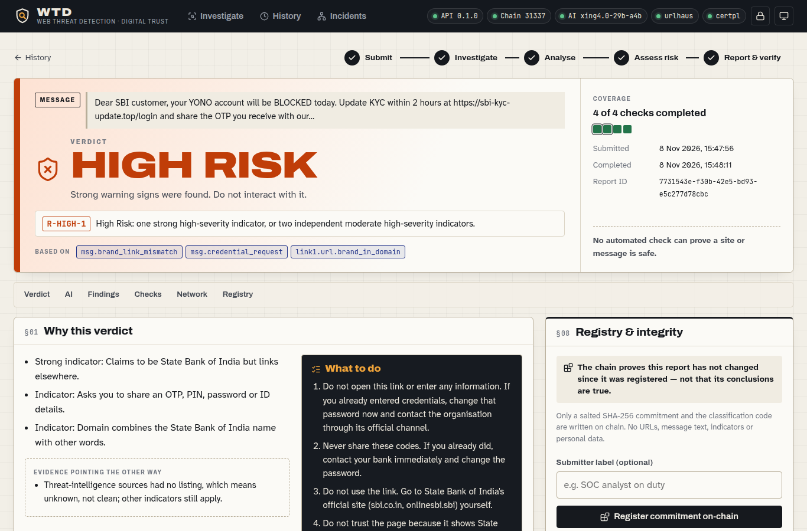

# WTD: Web Threat Detection & Digital Trust Intelligence

Paste a suspicious **link**, **message** or **raw e-mail** and get an evidence-based risk assessment. Every finding carries its source and its limitations. An AI explanation is grounded in those findings, and the report's integrity is anchored on-chain so anyone can check it independently.

Hackathon prototype (AI · Cybersecurity · Web3).

> Automated checks cannot prove a site or message is safe. "Low Risk" means no significant indicator was found in the checks listed in the report.

## What it does

| Requirement (problem statement §7) | Where |
|---|---|
| URL/domain investigation | `backend/wtd/pipeline.py`, isolated inspector (`inspector.py`, `fetcher.py`, `netguard.py`) |
| Phishing and impersonation indicators | homographs, typosquats, brand-in-domain/subdomain, fake-TLD labels, credential forms posting elsewhere, brand assets hot-linked, new domains (`checks/url_rules.py`, `checks/web_checks.py`, `checks/dns_checks.py`). **False positives measured** on real lists: [`docs/EVALUATION.md`](docs/EVALUATION.md) |
| HTTPS/TLS analysis and trust issues | `checks/tls_checks.py`: independent path verification, expiry, hostname, weak crypto, lifetime, CT, distrust lists (Chromium, Mozilla OneCRL, eMudhra fingerprints from Bugzilla 2083449) |
| AI evidence-grounded explanations | `ai/explain.py`: free OpenRouter model → local Ollama fallback; strict JSON schema; cited IDs, quotes and classification validated in code |
| Scam-message analysis | `message/analyse.py`: indicator extraction (URLs, emails, phones, UPI, wallets) and social-engineering rules; urgency alone is never fraud |
| E-mail security analysis | `message/email_checks.py`: paste or load raw `.eml`; receiving-server SPF/DKIM/DMARC, display-name and look-alike senders, Reply-To divergence, disguised links, risky attachments (never opened) |
| Structured, explainable risk | `classify.py`: five classes, auditable rules, coverage counts, contradictions listed |
| AI correlation | `incidents.py` + `ai/campaign.py`: deterministic clusters typed as campaign / shared infrastructure / repeat checks; validated AI campaign brief (cited indicators, reports and findings checked; verdict capped by link type) |
| Threat intelligence | CERT Polska Warning List (phishing domains) and URLhaus (malware URLs) with stated scope |
| On-chain threat-report registry | `contracts/src/ThreatReportRegistry.sol` (roles, ordered revisions, status history); register, revise and **independent review** (Validated/Disputed/Retracted, separate reviewer key, note hash on-chain) from the dashboard; local anvil chain, Sepolia tooling in `scripts/testnet.sh` |
| Independent verification | `verifier/verify.mjs` (Node + viem) recomputes the commitment and reads contract storage |
| Investigation dashboard | `frontend/` (React + Vite), served at `/` |
| ≥ 3 suspicious + 3 benign cases | `TESTING.md`, `docs/test-cases-observed.json` (12 cases, all matched) |
| Optional companion extension | `extension/` (MV3): page and link checks on click; opt-in warning before risky pages via a local-only quick check |

All six functional modules are covered: URL analysis, TLS trust, message analysis, deterministic correlation, passive website security assessment, and decentralised report integrity.

## Quick start (Ubuntu/macOS)

Prerequisites: [uv](https://docs.astral.sh/uv/), Node 20+, [Foundry](https://getfoundry.sh) (`forge`, `anvil`), curl. Optional: Ollama for the local AI fallback.

```bash
scripts/setup.sh                 # Python 3.13 env, contract build, npm installs, dashboard build, intel snapshots
# optional: edit .env → URLHAUS_AUTH_KEY=... (free key from your own abuse.ch account)
scripts/chain.sh start           # local chain (chain id 31337), state persisted in chain-state/
scripts/deploy.sh                # deploys ThreatReportRegistry, writes deployments/local.json
scripts/api.sh start             # API + dashboard on http://127.0.0.1:8000/
cat data/api_token               # operator token the dashboard asks for
```

Demonstrations:
- **Offline eMudhra-like demo.** This creates a clearly labelled SYNTHETIC report:

  ```bash
  (cd backend && .venv/bin/python -m wtd.demo tls-distrusted)
  ```

- **Independent verification.** Download a registered report from the dashboard ("Download report for independent verification"), then run:

  ```bash
  node verifier/verify.mjs --envelope wtd-threat-report-XXXX.json --deployment deployments/local.json
  # exit 0 = matches latest revision · 2 = superseded revision · 1 = altered / not anchored · 3 = error
  ```

Tests:

```bash
(cd backend && .venv/bin/python -m pytest -q)        # 118 tests: request boundary, TLS, classifier, messages, e-mail, AI validation (explanations and campaign briefs), API, persistence
(cd contracts && forge test)                          # 22 contract tests incl. unauthorised writes and revision ordering
node verifier/test-vectors.mjs                        # cross-language canonicalization vectors
backend/.venv/bin/python scripts/run_cases.py         # documented cases through the live API
(cd e2e && npm install && npm test)                   # real-browser click-through (Brave/Chrome, headless): dashboard 12 steps, extension 13 steps
backend/.venv/bin/python scripts/eval_url_rules.py --tranco top-1m.csv --tranco-id 94P72   # false-positive / detection evaluation (docs/EVALUATION.md)
```

The browser checks use an installed Brave or Chrome (`WTD_BROWSER=/path` to override) and save screenshots to `docs/screenshots/`.



## How it decides

| Class | Rule |
|---|---|
| Confirmed Malicious | Authoritative intelligence listing (e.g. a CERT Polska domain match, or an exact fresh URLhaus URL) |
| High Risk | One strong high-severity indicator, or two independent moderate high-severity ones |
| Inconclusive | Nothing significant found, but an essential check failed or was unavailable |
| Suspicious | One moderate indicator, or three weak ones |
| Low Risk | None of the above, with all essential checks completed |

Weak signals (urgent wording, keywords, AI observations, missing security headers) can never exceed Suspicious. Neither a valid certificate nor a missing intelligence listing ever lowers a result. Full methodology: [`docs/ARCHITECTURE.md`](docs/ARCHITECTURE.md). Web3 design and observed outputs: [`docs/WEB3.md`](docs/WEB3.md). API and schema: [`docs/INTERFACES.md`](docs/INTERFACES.md).

## Safety and privacy
- Arbitrary URLs are treated as hostile:
  - browser-equivalent parsing and an explicit block of private, loopback, metadata and IPv6-embedded addresses;
  - DNS answers are validated, and the connection goes only to a validated IP, with every redirect re-checked;
  - fetches run in a resource-limited child process with no secrets;
  - no scripts are executed, no downloads made, no ports scanned.
- Destinations already listed as malicious are **not visited**.
- Pasted messages are never stored raw. Personal identifiers are kept as keyed hashes and shown masked, and text is redacted before any AI call.
- Only free AI models are used, called with `data_collection: deny`. The AI cannot change findings or the classification; output contradicting them is marked `rejected`.
- Only a hash commitment and a classification code go on-chain. URLs, messages and personal data stay off-chain.

## Limitations (honest scope)
- The documented cases demonstrate coverage, not detection accuracy. The only measured figures are for the URL-rule layer alone (`docs/EVALUATION.md`): 0.4% flagged on 1,000 unseen popular sites, and 11% of held-out CERT Polska phishing domains caught without the feed.
- Intelligence scope:
  - CERT Polska focuses on threats to users in Poland;
  - URLhaus covers malware downloads, not phishing;
  - a no-hit means unknown.
- One page is fetched without running scripts, so cloaked phishing kits can look harmless. There is no screenshot or visual comparison.
- The brand list is curated (43 brands) and incomplete; some banks' new `.bank.in` domains are not yet listed.
- E-mail authentication results are taken from the pasted headers as recorded by the receiving server. Whoever pastes the message could edit them, and DKIM signatures are not re-verified.
- Revocation status:
  - OCSP is checked when the certificate lists a responder, and only signed, fresh responses count;
  - CRLs are not checked;
  - otherwise status is reported as unknown, never as "not revoked".
- The free AI model is rate-limited (HTTP 429 seen in testing). The local model is slower (about 15–45 s), and without either the report says "AI unavailable".
- The chain is a local anvil instance. Integrity holds under the contract's rules, but anvil's developer RPCs can rewrite local state. It proves a report has not changed, not that it is true.
- The optional browser companion (`extension/`) checks pages and links when you ask. Its opt-in warning mode looks at the address only, and the warning races the page load, so it is not a guaranteed block.

## Disclosures
- Open-source components and data sources are listed with licences in [`THIRD_PARTY_NOTICES.md`](THIRD_PARTY_NOTICES.md).
- At runtime the product uses AI models (OpenRouter free model; optional local Qwen3 4B) for explanations only.
- Development was assisted by AI coding tools.

Licence: Apache License 2.0 for original code in this repository (see `LICENSE` and `NOTICE`); third-party components keep their own licences.
